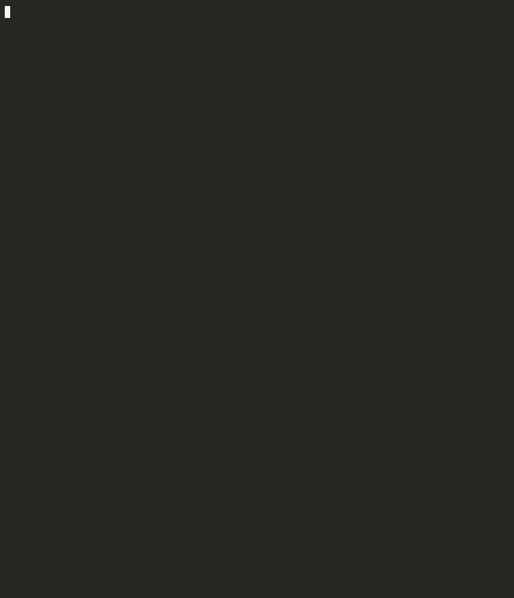

# Claude Skill Antivirus

[](https://www.npmjs.com/package/claude-skill-antivirus)
[](https://github.com/claude-world/claude-skill-antivirus/actions/workflows/ci.yml)
[](https://opensource.org/licenses/MIT)
[](https://nodejs.org/)
[](https://docs.anthropic.com/en/docs/claude-code)



A security scanner and safe installer for Claude Code Skills. It scans the **whole skill directory** — not just `SKILL.md` — to detect malicious patterns, hidden code, data exfiltration attempts, and dangerous operations before installing third-party skills.

Compatible with Claude Code using Opus 5.5, Sonnet 5.5, Haiku 5.5, and Fable 5.1 models.

[繁體中文說明](./README.zh-TW.md) | [SkillsMP Scan Report](./SCAN-REPORT.md)

## SkillsMP Platform Scan Results

We scanned all **71,577 skills** on SkillsMP:

| Risk Level | Count | Percentage |
|------------|-------|------------|
| CRITICAL | 91 | 0.13% |
| HIGH | 626 | 0.87% |
| MEDIUM | 1,310 | 1.83% |
| SAFE | **69,505** | **97.11%** |

**~3% of skills may have potential risks.** See [full report](./SCAN-REPORT.md) for details.

> **Coverage note**: this catalog scan (v2.0.0, January 2026) used the SkillsMP API, which exposes only each skill's `SKILL.md`, so "SAFE" there means no findings in the manifest; scripts were not analyzed (see [#33](https://github.com/claude-world/claude-skill-antivirus/issues/33)). Scan a skill's directory or repository for a complete verdict.

> **Note**: Some findings may be false positives (e.g., legitimate 1Password/Bitwarden integrations). Manual review is recommended for flagged skills.

## Features

- **Whole-directory scanning**: every file in a skill is analyzed — `scripts/`, nested
  folders, and even files inside `node_modules/`, `venv/`, or `__pycache__/`. Hidden code
  can no longer evade the scan by living outside `SKILL.md` (see [#33](https://github.com/claude-world/claude-skill-antivirus/issues/33)).
- **10 Security Scanning Engines**:
  - Dangerous Commands Scanner - Detects destructive shell commands
  - Data Exfiltration Scanner - Identifies data theft patterns
  - External Connections Scanner - Analyzes URLs and network calls
  - Permission Scanner - Reviews tool permissions and access scope
  - Pattern Scanner - Detects prompt injection and sensitive data
  - MCP Security Scanner - Validates MCP server configurations
  - SSRF Scanner - Identifies server-side request forgery patterns
  - Dependency Scanner - Detects malicious packages and typosquatting
  - Sub-agent Scanner - Detects Task tool abuse and agent chain attacks
  - File Artifact Scanner - Flags compiled/binary/archive artifacts (`.pyc`, `.so`, `.exe`, archives)

- **Tamper-evident coverage**: symlinks are never followed out of the skill, and skipped
  directories, truncated files, and scan-limit hits are reported as findings so an unusual
  input can never silently pass as SAFE.
- **Risk Assessment**: Critical, High, Medium, Low, and Info levels
- **Multilingual Support**: English and Traditional Chinese (繁體中文)
- **Install or Scan-Only Mode**: Review skills before installation
- **Interactive Prompts**: Guided decision-making for risky installations

## Requirements

- Node.js >= 22

## Installation

```bash
npm install -g claude-skill-antivirus
```

Or run it without installing:

```bash
npx claude-skill-antivirus <skill-source>
npx claude-skill-antivirus ./path/to/skill --scan-only
```

## Usage

### Install a skill with security scanning

```bash
# Install to project level (./.claude/skills/) - default
skill-install ./path/to/skill
skill-install https://github.com/user/skill-repo

# Install to user level (~/.claude/skills/)
skill-install ./path/to/skill --global
skill-install @skillsmp/example-skill -g
```

**Installation paths:**
- Project level (default): `./.claude/skills/`
- User level (`--global`): `~/.claude/skills/`

### Scan only (without installing)

```bash
skill-install ./path/to/skill --scan-only
skill-install https://github.com/user/repo/tree/main/skills/my-skill --scan-only
```

Every file in the skill is scanned. GitHub URLs (repository, `tree/` directory, or a `SKILL.md` blob) are walked through the GitHub API; set `GITHUB_TOKEN` to avoid unauthenticated rate limits. A skill that could not be scanned completely is reported, and is never installed.

### Change language

```bash
# English (default)
skill-install ./path/to/skill --lang en

# Traditional Chinese
skill-install ./path/to/skill --lang zh-TW
```

### Command names

A global install provides three interchangeable names for the installer, so
every example above works with any of them:

```bash
claude-skill-antivirus ./path/to/skill --scan-only
skill-install ./path/to/skill --scan-only
claude-skill-av ./path/to/skill --scan-only
```

`skill-batch-scan` is the separate batch tool described next.

### Batch scan all SkillsMP skills

```bash
# Scan all skills from SkillsMP (requires API key)
skill-batch-scan --api-key <your-api-key>

# Scan with options
skill-batch-scan --api-key <key> --max-pages 10 --verbose
skill-batch-scan --api-key <key> --output ./my-reports --lang zh-TW
```

Options:
- `-k, --api-key <key>` - SkillsMP API key (required)
- `-l, --limit <number>` - Skills per page (default: 100)
- `-p, --max-pages <number>` - Maximum pages to scan (default: all)
- `-o, --output <dir>` - Output directory for reports (default: ./scan-reports)
- `-v, --verbose` - Show verbose output
- `--lang <lang>` - Language (en, zh-TW)

## Scanning Engines

### 1. Dangerous Commands Scanner

Detects commands that can cause system damage:

| Risk Level | Detection Items |
|------------|-----------------|
| Critical | `rm -rf /`, `curl \| bash`, fork bombs |
| High | Reading `/etc/shadow`, reverse shells, credential theft |
| Medium | `rm -rf`, permission changes, service control |
| Low | `sudo`, global package installs |

### 2. Permission Scanner

Analyzes `allowed-tools` declarations:

- **Critical**: `Bash(*)` - Unrestricted shell access
- **High**: `Write`, `WebFetch`, broad bash permissions
- **Medium**: `Read`, `Glob`, `Grep`, version control tools
- **Dangerous Combinations**: e.g., `Read + WebFetch` = data exfiltration risk

### 3. External Connections Scanner

Identifies suspicious network activity:

- Direct IP URLs
- Webhook/data capture services
- Suspicious TLDs (.tk, .ml, etc.)
- Discord/Telegram webhooks
- URL shortening services

### 4. Pattern Scanner

Detects:

- Prompt injection attacks
- Hardcoded credentials/API keys
- Obfuscated code (base64, hex encoding)
- Social engineering language

### 5. Data Exfiltration Scanner

Specifically detects malicious behavior of reading local data and sending it externally:

| Category | Detection Items |
|----------|-----------------|
| Data Collection | Reading `.ssh`, `.aws`, `.env`, browser passwords, password managers |
| Data Exfiltration | `curl -d`, netcat transfers, DNS tunneling, email exfiltration |
| Combined Attacks | `cat \| base64 \| curl`, `tar \| nc`, `find -exec curl` |
| Env Variable Theft | `env \| curl`, `printenv` exfiltration |
| System Recon | `whoami`, `hostname`, network config exfiltration |
| Persistence | Modifying `.bashrc`, scheduled cron exfiltration |

### 6. MCP Security Scanner

Detects security risks in MCP Server configurations:

| Category | Detection Items |
|----------|-----------------|
| Untrusted Sources | Non-official MCP servers, direct URL execution |
| Dangerous Permissions | Unrestricted filesystem access, shell execution, database access |
| Sensitive Config | Environment variables with credentials, exposed config |
| Dangerous Combinations | Filesystem + Fetch, Shell + Network |

### 7. SSRF Scanner

Detects Server-Side Request Forgery and cloud attacks:

| Category | Detection Items |
|----------|-----------------|
| Cloud Metadata | AWS/GCP/Azure 169.254.169.254, IAM credential theft |
| Internal Network | 10.x.x.x, 192.168.x.x, 172.16-31.x.x probing |
| SSRF Bypass | Hex IP, URL encoding, file://, gopher:// |
| Kubernetes | API access, secrets theft, serviceaccount |
| Docker | docker.sock access, privileged containers, container escape |

### 8. Dependency Scanner

Detects malicious or vulnerable dependencies:

| Category | Detection Items |
|----------|-----------------|
| Known Malicious | event-stream, ua-parser-js, colors, faker |
| Typosquatting | crossenv, lodash-, mongose, reqeusts |
| Suspicious Install | URL installs, insecure registry, HTTP index |
| postinstall Risks | Install scripts with curl, wget, eval |

### 9. Sub-agent Scanner

Detects Task tool and sub-agent abuse:

| Category | Detection Items |
|----------|-----------------|
| Privilege Escalation | Task spawning Bash agent, requesting all permissions |
| Prompt Injection | Sub-agent prompts with malicious commands |
| Agent Chain Attacks | Nested Task calls, recursive agents |
| DoS Attacks | Loop Task calls, infinite recursion |
| Data Theft | Read + WebFetch combinations, accessing sensitive data |

### 10. File Artifact Scanner

Flags non-text artifacts that cannot be reviewed as source and are a common hiding place for payloads:

| Category | Detection Items |
|----------|-----------------|
| Compiled / native | `.pyc`, `.pyo`, `.so`, `.node`, `.dll`, `.dylib`, `.exe`, `.wasm`, `.class` |
| Archives | `.zip`, `.tar`, `.gz`, `.7z`, `.jar`, `.whl` bundled inside a skill |
| Binary content | Non-text files detected by content, with only their readable strings scanned |
| Coverage anomalies | Unexpected directories, unfollowed symlinks, truncated files, scan-limit hits |

## Output Examples

### Safe Skill

```
🔧 Claude Skill Installer v2.2.1

📦 Skill loaded: example-safe-skill

🔍 Starting security scan...

===========================================
     SECURITY SCAN REPORT
===========================================
Risk Level: ✅ SAFE

📊 Findings Summary:
  🟢 CRITICAL: 0
  🟢 HIGH:     0
  🟢 MEDIUM:   0
  🟢 LOW:      0
  ℹ️  INFO:     2

✅ Recommendation: Safe to install
```

### Malicious Skill Detected

```
🔧 Claude Skill Installer v2.2.1

📦 Skill loaded: suspicious-skill

🔍 Starting security scan...

===========================================
     SECURITY SCAN REPORT
===========================================
Risk Level: ☠️ CRITICAL

📊 Findings Summary:
  🔴 CRITICAL: 5
  🟠 HIGH:     3
  🟡 MEDIUM:   2
  🟢 LOW:      1
  ℹ️  INFO:     4

🔴 CRITICAL Findings:
  • [Data Collection] Reading sensitive credential files
    Attempts to read environment variables, private keys or credential files
  • [Data Exfiltration] curl sending command output
    Using curl to send command execution results to external server
  ...

❌ Recommendation: DO NOT INSTALL - Contains critical security risks
```

## Risk Levels

| Level | Score Impact | Action |
|-------|--------------|--------|
| CRITICAL | -30/item | Block installation |
| HIGH | -20/item | Require explicit confirmation |
| MEDIUM | -10/item | Show warning |
| LOW | -5/item | Show in verbose mode |
| INFO | 0 | Always show |

## API

You can also use the scanner programmatically:

```javascript
import { SecurityScanner, loadSkill } from 'claude-skill-antivirus';

const scanner = new SecurityScanner();
const skill = await loadSkill('./path/to/skill'); // local dir, SKILL.md, zip, or GitHub URL
const result = await scanner.scan(skill);

console.log(result.riskLevel); // 'SAFE' | 'LOW' | 'MEDIUM' | 'HIGH' | 'CRITICAL'
console.log(result.score);     // 0-100
console.log(result.findings);
// {
//   critical: [...],
//   high: [...],
//   medium: [...],
//   low: [...],
//   info: [...]
// }
```

## Project Structure

```
claude-skill-antivirus/
├── src/
│   ├── index.js                   # CLI entry point
│   ├── i18n/                      # Internationalization
│   │   ├── index.js
│   │   ├── en.js                  # English translations
│   │   └── zh-TW.js               # Traditional Chinese translations
│   ├── lib.js                     # Programmatic API entry (no CLI side effects)
│   ├── version.js                 # Single source of truth for the version
│   ├── scanner/
│   │   ├── index.js               # Main scanner (integrates 10 engines)
│   │   ├── dangerous-commands.js  # Dangerous command detection
│   │   ├── permissions.js         # Permission checking
│   │   ├── external-connections.js # External connection analysis
│   │   ├── patterns.js            # Pattern matching
│   │   ├── data-exfiltration.js   # Data exfiltration detection
│   │   ├── mcp-security.js        # MCP Server security check
│   │   ├── ssrf-scanner.js        # SSRF/cloud attack detection
│   │   ├── dependency-scanner.js  # Dependency security check
│   │   ├── subagent-scanner.js    # Sub-agent attack detection
│   │   └── file-artifacts.js      # Compiled/binary/archive artifact detection
│   └── utils/
│       ├── downloader.js          # Skill loader (walks the whole directory)
│       └── installer.js           # Skill installer
├── examples/
│   ├── safe-skill/                # Safe example
│   ├── malicious-skill/           # Malicious example (tests all engines)
│   └── hidden-code-skill/         # Hidden-code example (payload outside SKILL.md, #33)
├── test/
│   ├── scan.test.js               # Regression suite (node --test)
│   └── bin.test.js                # Every declared bin resolves and ships
├── package.json
└── README.md
```

## Latest Updates

### v2.2.1 (2026-10-21)
- **Fixed the documented `npx claude-skill-antivirus` command**, which failed with "could not determine executable to run" because no bin matched the package name. `claude-skill-antivirus` is now a bin alias alongside `skill-install` and `claude-skill-av`, and a test asserts every declared bin resolves, runs `--version`, and ships in the tarball.
- `--help` now reports the alias you actually typed instead of always printing `skill-install`.
- npm publishing moved to [trusted publishing](https://docs.npmjs.com/trusted-publishers) (OIDC), so releases are signed with provenance and no long-lived npm token exists in CI.

### v2.2.0 (2026-10-21)
- **Security fix ([#33](https://github.com/claude-world/claude-skill-antivirus/issues/33))**: the scanner now walks the **whole skill directory** instead of reading only `SKILL.md`, so hidden code in `scripts/`, nested folders, or a poisoned `__pycache__/*.pyc` can no longer score a false SAFE 100/100. Reported by [@nedlir](https://github.com/nedlir); directory-walk foundation by [@Yahhi](https://github.com/Yahhi) ([#34](https://github.com/claude-world/claude-skill-antivirus/pull/34)).
- New **File Artifact Scanner** (10th engine) flags compiled/binary/archive files by magic bytes, and a PEP 552 unchecked-hash `.pyc` is CRITICAL; skipped dirs, unfollowed symlinks, truncated files, and scan-limit hits are now reported as findings.
- GitHub repository, `tree/` and `blob/.../SKILL.md` URLs walk the whole skill via the GitHub API; `.zip` inputs are hardened (zip-slip, encrypted/oversized entries, size caps).
- Installer hardening: refuses zip-slip paths and incompletely scanned skills, and writes binaries byte-for-byte.
- Fixed ReDoS across the engines (a crafted long line could hang the scanner) and a crash on SKILL.md files containing a `| name |` table.
- Pattern precision tuned for real code now that scripts are scanned. Skills that ship scripts will show more findings than in 2.1.x; review them.
- Verified compatibility with Claude Code Opus 5.5, Sonnet 5.5, Haiku 5.5, and Fable 5.1.
- Node.js >= 22; upgraded dependencies (commander 15, inquirer 14, chalk 6, ora 9, yaml 2.9, adm-zip 0.6); removed `node-fetch` in favor of built-in `fetch`.

### v2.1.0 (2026-03-13)
- Verified compatibility with Claude Code Opus 4.6
- Updated documentation and metadata

### v2.0.1
- Separated capability warnings from actual threats in permission scanner
- Fixed array format handling in `allowed-tools`

### v2.0.0
- Added 4 new scanning engines: MCP Security, SSRF, Dependency, and Sub-agent scanners (total: 9 engines)
- Added i18n support (English + Traditional Chinese)
- Added batch scanner for SkillsMP platform
- Scanned all 71,577 skills on SkillsMP

### v1.0.0
- Initial release with 5 core scanning engines
- CLI installer with interactive prompts

## Related Projects

- [cf-browser](https://github.com/claude-world/cf-browser) - Open-source Cloudflare Browser Rendering proxy with 9 MCP tools for Claude Code
- [claude-world.com](https://claude-world.com) - Claude Code advanced usage community

## Contributing

Contributions are welcome! Please feel free to submit issues and pull requests.

### Adding New Detection Patterns

Each scanner is modular. To add new patterns:

1. Find the appropriate scanner in `src/scanner/`
2. Add your pattern to the relevant array
3. Include: `pattern`, `risk`, `title`, `description`

## License

MIT

## Author

Lucas Wang <support@claude-world.com>

## Links

- [GitHub Repository](https://github.com/claude-world/claude-skill-antivirus)
- [npm Package](https://www.npmjs.com/package/claude-skill-antivirus)
- [Report Issues](https://github.com/claude-world/claude-skill-antivirus/issues)
